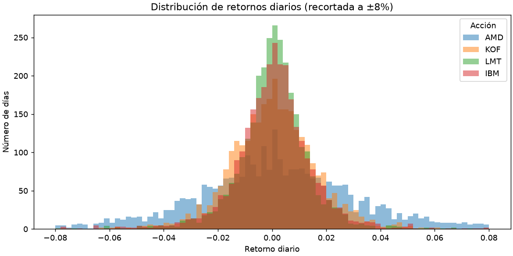
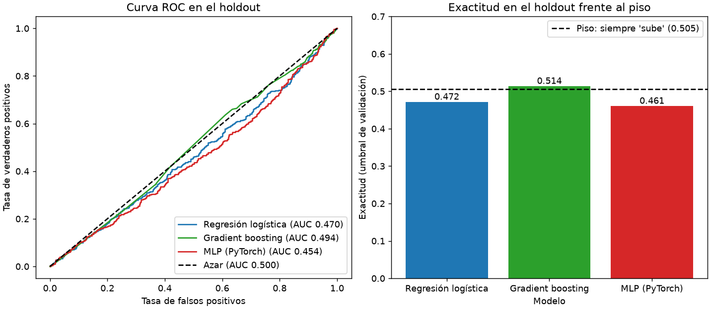
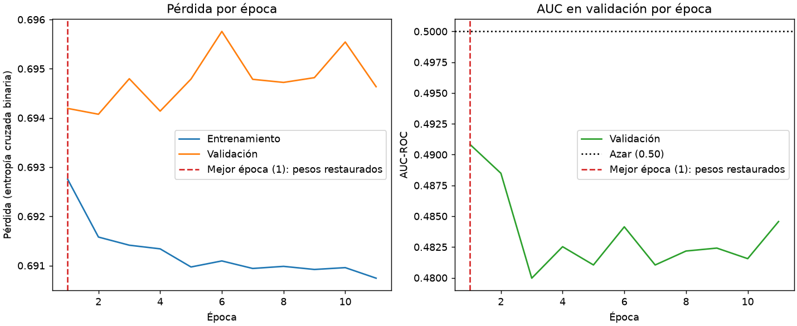
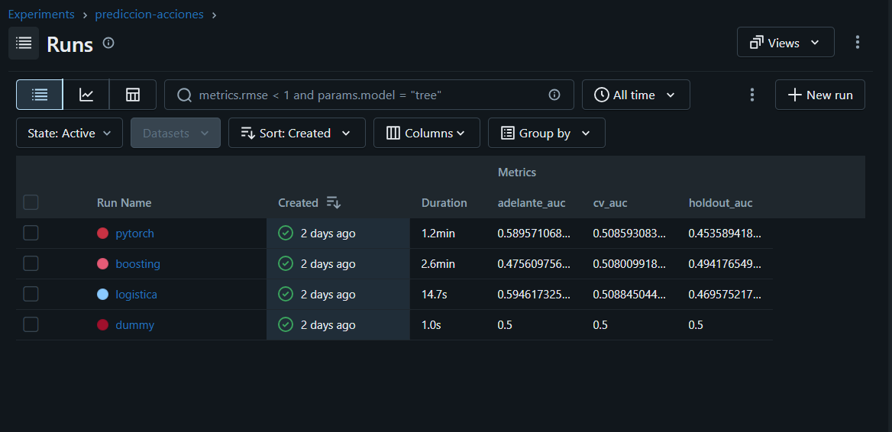

# Predicción de la dirección diaria de acciones

Pipeline de Machine Learning de punta a punta (datos, validación, modelos, API y contenedor) que estima la probabilidad de que una acción suba o baje al día siguiente. Compara una regresión logística, un gradient boosting y una red neuronal en PyTorch contra una línea base.

- **Estudiante:** Aldo Gutierrez
- **GitHub:** [AldoEmmanuelG](https://github.com/AldoEmmanuelG) · repositorio: [prediccion-acciones](https://github.com/AldoEmmanuelG/prediccion-acciones)
- **Contexto:** Proyecto final del Módulo 1, Diplomado en AI & LLM for Financial Markets (ITAM).

## Resultado en una línea

Los modelos **no superan al azar de forma demostrable**: el AUC de validación es ≈ 0.51 en todos y en el holdout oscila alrededor de 0.50; la exactitud en el holdout queda por debajo o a la par del piso de 0.505 que logra responder siempre "sube" (ver [Resultados](#4-resultados)). Es lo esperado al predecir la dirección diaria con datos públicos de precios, y el proyecto lo reporta tal cual en lugar de ocultarlo.

## 1. Instalación

Requisitos: Python 3.12, [uv](https://docs.astral.sh/uv/) y Git. Docker solo se necesita para el contenedor.

```bash
git clone https://github.com/AldoEmmanuelG/prediccion-acciones.git
cd prediccion-acciones
uv sync
```

Variables de entorno (no hay llaves de API; todo es opcional):

```bash
cp .env.example .env
```

En PowerShell: `Copy-Item .env.example .env`.

Los modelos entrenados están en la carpeta `models/` y se versionan directamente en Git (pesan unos pocos MB en total, muy por debajo del límite de 100 MB), así que **no hace falta descargar nada más** para construir la imagen o levantar la API.

## 2. Cómo ejecutar

### API con Docker

Un solo comando para construir y otro para correr, sin pasos manuales:

```bash
docker build -t prediccion-acciones .
docker run --rm -p 8000:8000 prediccion-acciones
```

Abre `http://localhost:8000` para la **página web**, que consume la API, o `http://localhost:8000/docs` para la documentación interactiva. La página tiene tres pestañas: *Resumen de las 10* (probabilidad de subir de cada acción), *Detalle por acción* (predicción, gráfica de precio con medias móviles y cómo le fue al modelo en los días posteriores al corte) y *Acerca del modelo* (comparación contra el piso, gráfica de AUC y lectura del resultado). Las gráficas se dibujan en el navegador con SVG, sin librerías externas.

Los endpoints principales son `/health` y `/predict`; los otros tres, de solo lectura, alimentan la página:

| Endpoint | Qué hace |
|---|---|
| `GET /health` | Estado del servicio, modelos cargados, fecha de entrenamiento y tickers disponibles. |
| `POST /predict` | Probabilidad de que la acción suba en el siguiente cierre. |
| `GET /resumen` | Las 10 acciones con su probabilidad de subir, de mayor a menor. |
| `GET /series/{ticker}` | Cierre y medias móviles de los últimos días, y las predicciones sobre días posteriores al corte. |
| `GET /modelos` | Métricas de cada modelo contra el piso de exactitud. |

Ejemplo:

```bash
curl -X POST http://localhost:8000/predict -H "Content-Type: application/json" -d '{"ticker": "AMD", "modelo": "logistica"}'
```

La respuesta incluye `ticker`, `modelo`, `fecha_datos`, `cierre`, `probabilidad_sube`, `umbral` y `prediccion` (`"sube"` o `"baja"`). El campo `modelo` es opcional (`logistica` por defecto, o `pytorch`). Un ticker que no existe (o un modelo que no está cargado) responde **422** con un mensaje claro, no un error 500. El modelo se carga **una sola vez** al arrancar el servicio, no en cada petición.

Para que otro dispositivo de la misma red entre, usa `http://<IP-de-la-máquina>:8000` y permite el puerto 8000 en el firewall (perfil de red Privado).

### API sin Docker (desarrollo)

```bash
uv run uvicorn prediccion_acciones.api.main:app --port 8000
```

### Entrenar

```bash
uv run dvc repro
```

Es equivalente a `uv run python -m prediccion_acciones.entrenamiento`, pero DVC solo vuelve a correr si cambiaron los datos, la configuración o el código. Genera `models/` y las tres figuras de `reports/`. Opciones del script directo: `--modelos`, `--sin-mlflow`, `--sin-cache` (vuelve a descargar los precios).

### Pruebas y estilo

```bash
uv run pytest -q
uv run ruff check .
uv run ruff format --check .
```

Hay más de 130 pruebas, entre ellas las del contrato de la API con `TestClient` (`tests/test_api.py`), que revisan `/health`, una predicción válida y los casos de entrada inválida (422).

### App de Streamlit (heredada, opcional)

Antes de la API, el proyecto tenía una interfaz en Streamlit. Se conserva como grupo opcional de dependencias y ya no va en la imagen de Docker; la página web actual es la de `/`:

```bash
uv sync --group web
uv run streamlit run src/prediccion_acciones/app/main.py
```

## 3. Problema y datos

**Problema.** Clasificación binaria: dado el cierre de hoy, ¿el cierre de mañana será mayor? La etiqueta es `y = 1` si `Close(t+1) > Close(t)`. Se entrena un solo modelo sobre el panel de 10 acciones.

**Acciones objetivo:** AMD, ORCL, IT, IBM, OSIS, LMT, KOF, HUM, ANF, LII. **Contexto** (configurado, pero no usado en esta versión): SPY y NVDA figuran en `config.yaml` como tickers de contexto, pero no se descargan ni entran al modelo; este solo recibe los indicadores calculados de cada acción objetivo. Usarlos como características queda como mejora futura.

**Fuente:** Yahoo Finance vía `yfinance`, precios ajustados por splits y dividendos, desde 2015-01-01.

**13 características** (solo retornos y razones, nunca precios en bruto; usan datos hasta el cierre del día):

| Grupo | Características |
|---|---|
| Retornos rezagados | `ret_1d`, `ret_2d`, `ret_5d`, `ret_10d` |
| Ventanas móviles (5, 10, 20 días) | `media_*d` y `desv_*d` del retorno |
| Técnicas | `rsi_14`, `dist_media_20d`, `vol_rel` (volumen relativo) |

**Valores faltantes.** No se imputan: se eliminan. Los días sin cierre o volumen se descartan al cargar, las primeras filas de cada acción (donde las ventanas móviles aún no tienen datos) y los valores infinitos se eliminan al construir las características, y los últimos días de cada acción se quitan porque su cierre siguiente aún no se conoce. Imputar con la media del periodo completo metería información del futuro, y con tan pocos huecos descartar es más simple y seguro.

**Validación de datos (Pandera).** Un `DataFrameSchema` revisa tipos, rangos (cierre > 0, volumen ≥ 0), nulos, pares (fecha, ticker) únicos y columnas sin extras. Un cambio diario mayor al 60 % genera una advertencia. Si algo falla, el pipeline se detiene con un mensaje claro.

**Partición temporal (sin fuga de información):**

| Periodo | Fechas | Uso |
|---|---|---|
| Entrenamiento | 2015-02-02 → 2026-03-20 | Ajuste y validación cruzada |
| Holdout | 2026-03-30 → 2026-09-30 (1,280 filas) | Se abre **una sola vez** |
| Hacia adelante | 2026-10-01 → 2026-10-09 (70 filas) | Días posteriores al corte |

La validación cruzada es `TimeSeriesSplit` de 5 pliegues con un hueco (`gap`) de 5 días entre entrenamiento y validación. Los modelos finales se reentrenan con datos hasta la fecha de corte. El umbral de decisión de cada modelo se elige con el índice de Youden sobre las predicciones fuera de muestra de la validación cruzada.

### Exploración



Distribución de los retornos diarios de las 10 acciones. Los días de subida son poco más de la mitad del total, y eso fija el piso contra el que se compara todo: un modelo que siempre responde "sube" ya acierta ≈ 50 % en el holdout.

## 4. Resultados

Métricas principales: **AUC-ROC** (¿el modelo ordena bien los días de subida frente a los de bajada?, 0.50 = azar), **exactitud** (proporción de aciertos) y **F1** (equilibrio entre precisión y exhaustividad de los días de subida).

El **piso** es la exactitud del modelo dummy, que siempre responde la clase mayoritaria: **0.505** en el holdout. Un modelo solo aporta si lo supera.

| Modelo | AUC validación | AUC holdout | Exactitud holdout | F1 holdout | ¿Supera el piso (0.505)? |
|---|---|---|---|---|---|
| Dummy (piso) | 0.500 | 0.500 | 0.505 | 0.672 | — |
| Regresión logística | 0.509 ± 0.017 | 0.470 | 0.472 | 0.541 | No |
| Gradient boosting | 0.508 ± 0.019 | 0.494 | 0.514 | 0.579 | Por 0.9 puntos, dentro del ruido |
| MLP (PyTorch) | 0.509 ± 0.012 | 0.454 | 0.461 | 0.545 | No |



**Conclusión.**

- Los tres modelos tienen el mismo AUC de validación (≈ 0.51), prácticamente el azar. Con 1,280 filas el ruido del AUC en el holdout es de ±0.03, así que las diferencias entre 0.45 y 0.49 no son concluyentes.
- Ningún modelo supera el piso de forma creíble: el boosting queda 0.9 puntos arriba, una diferencia menor que el ruido de la muestra, y la logística y la red quedan por debajo.
- El **F1 del dummy es el más alto** por una razón mecánica: responder siempre "sube" da buen F1 sin ninguna capacidad predictiva. Por eso el AUC y la exactitud contra el piso son las métricas principales y el F1 solo complementa.
- La prueba hacia adelante tiene solo 70 filas: un AUC de 0.59 ahí es ruido, no evidencia.
- Lectura honesta: con estas características el mercado diario es casi impredecible.

### Curvas de aprendizaje de la red (PyTorch)



**Diagnóstico.** La pérdida de entrenamiento baja de 0.6928 a 0.6907 y la de validación se queda en ≈ 0.694–0.696; ambas rondan **ln 2 ≈ 0.693**, que es la pérdida de un modelo que siempre responde 50 %. Es el patrón de "las dos altas y pegadas": la red no aprende nada útil porque **los datos casi no tienen señal**, no porque le falte capacidad ni porque se sobreajuste. El AUC de validación es mejor en la época 1 (0.491) y luego empeora, por lo que el *early stopping* detuvo el entrenamiento en la época 11 (paciencia de 10) y se conserva la **época 1**.

Se descartó que fuera un problema de capacidad: en el notebook `03` se probaron 12 combinaciones de capas, *dropout* y tasa de aprendizaje, y ninguna salió de ese patrón. Hacer la red más grande no ayudaría; el límite está en la información de las características.

### Búsqueda de hiperparámetros

`GridSearchCV` dentro de la validación cruzada temporal, con AUC como métrica de selección (`refit`) y F1 reportado en paralelo (`evaluation/busqueda.py`).

| Modelo | Qué se probó | Qué se encontró |
|---|---|---|
| Logística | `C` ∈ {0.001, 0.01, 0.1, 1, 10} | Ganó `C = 0.001`, el extremo más regularizado de la rejilla |
| Boosting | `max_depth` ∈ {2, 3, 4, 6} × `learning_rate` ∈ {0.01, 0.03, 0.1} | Ganó `max_depth = 2`, `learning_rate = 0.01`, el modelo más simple |
| MLP (PyTorch) | Capas [32, 16], dropout 0.2, Adam (lr 0.001, L2 1e-4), early stopping por AUC con paciencia 10 | Configuración fija de `config.yaml`; la exploración manual está en el notebook `03` |

Ambos ganadores están en el extremo "más simple" de su rejilla. Es la señal típica de que casi no hay patrón que aprender: la validación cruzada prefiere modelos que se parecen al azar.

### Seguimiento de experimentos (MLflow)

Cada entrenamiento registra parámetros, métricas y el modelo en MLflow (SQLite local `mlflow.db`). Para verlo:

```bash
uv run mlflow ui --backend-store-uri sqlite:///mlflow.db
```



*Una corrida por modelo, con el AUC de validación cruzada (`cv_auc`), del holdout (`holdout_auc`) y de la prueba hacia adelante (`adelante_auc`). El dummy marca el piso de 0.5. La prueba hacia adelante tiene solo 70 filas, así que es muy ruidosa y no debe leerse como una mejora real.*

## 5. Arquitectura

```
Yahoo Finance ──► descarga ──► Pandera ──► features + etiqueta ──► partición temporal
 (yfinance)      (reintentos)  (esquema)     (13 variables)        entrenamiento / holdout / adelante
                                                                          │
                                  ┌───────────────────────────────────────┘
                                  ▼
                 Fábrica de modelos ──► dummy · logística · boosting · MLP (PyTorch)
                                  │
                       validación cruzada + búsqueda ──► umbral (Youden)
                                  │
                    ┌─────────────┴──────────────┐
                    ▼                            ▼
              MLflow (SQLite)             models/ (.joblib, .pt, metricas.json)
         parámetros, métricas, artefactos         │  (versionado en Git)
                                                  ▼
                                 FastAPI (/health, /predict) ──► Docker
```

```
src/prediccion_acciones/
├── config.py            # lee configs/config.yaml (dataclasses inmutables)
├── entrenamiento.py     # orquesta todo el flujo
├── reportes.py          # genera las tres figuras de reports/
├── seguimiento.py       # MLflow detrás de una interfaz
├── data/                # descarga, esquemas Pandera, utilidades (decoradores)
├── features/            # ingeniería de variables y partición temporal
├── models/              # BaseModel, fábrica, sklearn, PyTorch
├── evaluation/          # métricas, validación cruzada, búsqueda
├── api/                 # FastAPI: esquemas Pydantic, endpoints y página web (static/)
└── app/                 # servicio (lógica compartida), gráficas y pantalla de Streamlit
```

## 6. Decisiones de diseño

| Patrón / técnica | Dónde | Por qué |
|---|---|---|
| **Template Method** (clase abstracta `BaseModel`) | `models/base.py` | Define el contrato común (`fit`, `predict_proba`, `predict`, `guardar`, `cargar`) y valida entradas una sola vez; cada modelo solo implementa `_ajustar` y `_probabilidad`. |
| **Factory** (decorador `@registrar`) | `models/base.py` y `models/fabrica.py` | Crear un modelo por nombre desde la configuración, sin `if/else` en el flujo. Agregar un modelo es registrarlo. |
| **Strategy** | `entrenamiento.py` | El flujo trata igual a sklearn y PyTorch porque comparten la interfaz; cambiar de modelo no cambia el flujo. |
| **Null Object** (`SeguimientoNulo` / `SeguimientoMLflow`) | `seguimiento.py` | Entrenar con o sin MLflow sin llenar el código de `if usar_mlflow`. Las pruebas corren sin tracking. |
| **Dataclasses inmutables** | `config.py`, resultados | Configuración y resultados con campos nombrados; `frozen=True` evita modificarlos por accidente. |
| **Decoradores** `medir_tiempo`, `reintentar` | `data/utilidades.py` | Tiempo de ejecución de la descarga y reintentos ante fallas de red. |
| **Context manager** `cronometro` | `data/utilidades.py` | Mide bloques de código; `joblib.dump` y `torch.save` también ocurren dentro de `with`. |
| **Separación API / servicio** | `api/main.py` vs `app/servicio.py` | La lógica (cargar artefactos, predecir) se prueba sin levantar un servidor, y la API y la app de Streamlit la comparten. |

**Trade-offs.**

- Un solo modelo para las 10 acciones (panel) en vez de uno por acción: más datos por modelo y menos riesgo de sobreajuste, a costa de ignorar diferencias propias de cada acción.
- Características como retornos y razones, no precios: el mismo modelo sirve a todas las acciones, a costa de perder el nivel de precio.
- Se priorizó evitar fugas de información (huecos en la validación, holdout abierto una vez, escalado dentro del `Pipeline`) sobre obtener métricas más vistosas.
- Los modelos viven en Git (pocos MB) para que `docker build` funcione sin pasos manuales; DVC versiona los datos crudos y define las etapas reproducibles (`entrenar`, `reportes`).
- La API expone la logística y la red; el boosting queda en el pipeline y las métricas, pero fuera del servicio para mantenerlo simple.
- Docker usa `python:3.12-slim` con `uv`, capas ordenadas para aprovechar la caché (dependencias antes que el código), PyTorch solo CPU para reducir tamaño, usuario sin privilegios y `HEALTHCHECK` sobre `/health`.

### Nota sobre DVC

El remoto configurado (`almacen_local`) es una carpeta local en el equipo del autor, como permitió el curso. En otra máquina `dvc pull` de los datos crudos no encontrará esa carpeta. Alternativa sin remoto: `uv run dvc repro` vuelve a descargar los precios desde Yahoo Finance y reentrena; el resultado se reproduce con las mismas métricas porque la semilla y las fechas están fijas en `configs/config.yaml`.

## Aviso

Proyecto académico. No constituye asesoría financiera ni de inversión.
